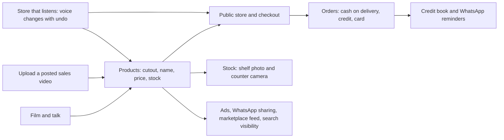

# Tadasouk

**Film your products and talk. Your store builds itself.**

[](https://youtu.be/h1okA4JU-Go)

- Demo video (2 min 57 s): https://youtu.be/h1okA4JU-Go
- Live app: https://tadasouk.com (sign up, then film a few products)
- Demo store: https://tadasouk.com/test
- Built for the Meta Global AI Developer Hackathon 2026, indie track, theme "Build for Your World"
- Open source under AGPL-3.0

A small merchant in Morocco opens this PWA, presses one big record button, films their products
and talks. The store builds itself on screen: each product is cut out of the video, prices and
discounts are set by voice in Darija, French, Arabic or English.

The project was called SmallStore during most of the event; some file names and internal keys
keep that name.

## At a glance

| | |
|---|---|
| **Who it is for** | Small merchants who sell through social media posts and WhatsApp today, starting with Morocco's informal and home-based shops |
| **What they do** | Film products and talk, as they already do for Instagram. Nothing to type. |
| **What they get** | A public store with real product photos, names and descriptions in French and Arabic, prices checked against local shops, a checkout, and a back office they run by voice |
| **Meta models** | Four Meta models through the Meta Model API, for reasoning, segmentation, images and speech: Muse Spark 1.3, SAM 3.1, Muse Image 1.0 and Muse Voice Transcribe 1.0, behind 17 API routes |
| **Meta platforms** | WhatsApp (receipts, reminders, store sharing with link previews), Instagram Login (video import), Facebook and Instagram ad texts |
| **State** | Live at tadasouk.com, written from an empty repository during the event |

## The problem

Most small merchants never open an online store. A store builder asks for product photos,
written descriptions, prices typed one by one, stock numbers, often a registered company and a
card account. A shop run from home, by one person who also buys, sells, delivers and collects
payments, gives up at the first form. These merchants keep posting product videos on Instagram
and Facebook, then answer "Price?" in the comments and take orders on WhatsApp.

The numbers for the first market, Morocco:

- **2.03 million informal production units** in 2023, employing 2.53 million people, with a
  turnover of 526.9 billion dirhams; only 9.8% of them are affiliated with social security
  ([HCP, national survey on the informal sector 2023/2024](https://m.hcp.ma/file/244334)).
- **85.5% of those units have a single job**: one person does everything
  ([Le360 on the HCP survey](https://fr.le360.ma/economie/secteur-informel-le-diagnostic-detaille-du-hcp_45XPLJ5C4VGBDHERYSMN3CZLPA/)).
- **Trade is the largest activity: 47% of those units**, about 950,000 informal trading
  businesses ([Le360 on the HCP survey](https://fr.le360.ma/economie/secteur-informel-le-diagnostic-detaille-du-hcp_45XPLJ5C4VGBDHERYSMN3CZLPA/)).
- **Neighbourhood shops are 80% of the country's points of sale**, according to the Minister of
  Industry and Trade ([Hespress](https://fr.hespress.com/400165-modernisation-du-commerce-de-proximite-mezzour-detaille-son-plan.html)).
- **The buyers are already online**: 35.3 million internet users and 21.3 million social media
  user identities in January 2025 ([DataReportal, Digital 2025: Morocco](https://datareportal.com/reports/digital-2025-morocco)).
- **Online card payments stay small**: 28.1 million transactions for 9.6 billion dirhams in 2022
  ([CMI via Hespress](https://en.hespress.com/60789-60789.html)), next to the 526.9 billion dirhams
  the informal sector turns over in a year.

The same pattern holds far beyond Morocco: about 2 billion people, over 60% of the world's
employed population, work in the informal economy ([ILO](https://www.ilo.org/resource/news/more-60-cent-worlds-employed-population-are-informal-economy)),
and WhatsApp Business passed 200 million monthly active users in 2023 ([LatestLY on Meta's
announcement](https://www.latestly.com/technology/whatsapp-business-achieves-over-200-million-monthly-active-users-globally-up-from-50-million-back-in-2020-5229566.html)).

## The impact

Tadasouk keeps the merchant's habit (film a product, talk about it) and removes every step they
gave up on:

- **No typing.** The price, the discount and the stock come from what the merchant says, in
  Darija, French, Arabic or English. A product goes from the camera to a store card in one take.
- **Real photos without a studio.** SAM 3.1 cuts the real product out of the video; Muse Image 1.0
  adds angles the camera did not see, starting from that real photo.
- **A fair price.** Muse Spark 1.3 searches Moroccan shops and shows the lowest, average and
  highest price with a suggested price, before the merchant picks one.
- **Sales the way these merchants sell.** Cash on delivery and credit are first-class, with a
  credit book and WhatsApp reminders; card payment comes through an existing service.
- **Stock they can trust.** A shelf photo or a phone fixed over the counter counts the stock, so
  the store can later list on marketplaces that require accurate stock.
- **Open source.** Anyone can start the same service in their own country.

## How Meta's models do the work

Every AI call in the product goes to the Meta Model API through one server file
(`src/lib/server/meta.ts`) that adds the key, checks the merchant's AI credit and the platform's
daily cap, and logs one usage row per call.

| Meta model | Jobs in the app |
|---|---|
| **Muse Spark 1.3** (reasoning, tool calls, image understanding, web search) | Live voice agent with tool calls; the back office that listens; names, descriptions and categories; sales video reading; local price check with web search; stock count from shelf photos; stock camera; hold-to-frame grounding; photo quality score; credit entry by voice; ad texts |
| **SAM 3.1** (segmentation) | Cuts each product out of the video from the on-device detector's box or a single tap |
| **Muse Image 1.0** (images) | Product photos from other angles, from the seller's real photo; the store's banner |
| **Muse Voice Transcribe 1.0** (speech to text) | Turns the merchant's speech into text for the captions and both agents |

The detailed list, with the file behind each call, is in [Meta models used](#meta-models-used).

## The merchant's tools



- **Capture**: live camera with voice, or import of a sales video already posted.
- **Store**: public store per merchant at `tadasouk.com/{store}`, categories, search, product
  pages, cart, checkout, order tracking page.
- **Back office**: orders, products, sales, settings, and a microphone that changes the store
  by voice with an undo for each change.
- **Tools**: credit book filled by voice, stock count from shelf photos, stock camera over the
  counter, ad texts in French, Darija and Arabic, marketplace product feed with a stock safety
  margin, search and AI visibility (sitemap, robots.txt, llms.txt per store), in-shop QR payment.

## Built during the hackathon

This repository was started empty for the **Meta Global AI Developer Hackathon** (indie track,
2026-10-26 to 2026-11-04). The first commit is dated 2026-10-27. Everything below was written
during the event; [CHANGELOG.md](CHANGELOG.md) and the commit history give the day-by-day timeline.

Built so far:

- **Live video capture**: one record button, camera and microphone on the phone, auto-capture when
  a product is held still in the centre, a shutter button, and hold-to-frame (hold the screen,
  then resize a frame around the product).
- **Product highlighting and cutouts**: an on-device detector outlines the product in real time;
  SAM 3.1 cuts it out and the phone puts it on a white background with a soft shadow. The same
  product shown twice is recognised and not captured again.
- **Voice agent for pricing and discounts**: short speech chunks are transcribed and an agent
  turns them into actions (set price, discount, rename, description, stock, remove, undo,
  next product) and asks about missing information.
- **Automatic research per product**: name and description, three AI photos from other angles,
  photos from shop pages on the web, and a price check against Moroccan shops (lowest, average,
  highest, suggested price).
- **Sales video import**: the merchant uploads a video they already posted; the products are
  read from the moments the phone was held still and from what the seller says, and the same
  product filmed from two sides becomes one product.
- **Product cards, product sheet and photo preview** with a quality score per photo.
- **Barcodes**: read from the video and attached to the product.
- **Sale screen**: scan products at the counter, update stock, send the receipt on WhatsApp.
- **Merchant accounts**: "Continuer avec Google", or an email with a password, or a phone number
  with a code sent on WhatsApp (the merchant writes first, so the reply with the code is free).
  A first visit names the store; the back office opens on the red record button.
- **AI credit per account**: every Meta Model API call is charged to the signed-in account: $2
  given once at sign-up to the first 10 accounts, later accounts activated by the owner in
  `/admin`; a platform daily cap stays as a safety net. One usage row per call.
- **Public store** at `/{slug}`: home (hero photo uploaded or made by muse-image-1.0, best
  sellers, categories), category pages with sorting and colour/size filters, search, product
  pages (gallery per colour, sizes with sold-out ones greyed, suggestions, WhatsApp previews
  through Open Graph, schema.org Product data), a cart drawer, a cart page with the delivery
  methods, a two-column checkout (cash on delivery, credit, or card through Tchentchen once its
  keys are set) and a thank-you page.
  The database prices every cart and order (`quote_cart`, `place_order`): colours and sizes,
  delivery free above a threshold, promotion codes.
- **Merchant back office**: a shop menu (home, products, sales, settings) with the red record
  button in the middle, French and English, a first-visit guide; every filmed product saved as a
  draft (photos on Cloudflare R2), put online by a button or by voice; categories proposed by
  the AI at capture (reusing the store's own), colours, sizes and sold-out combinations, delivery
  methods, promotion codes; counter sale with the saved products.
- **Stock count from a shelf photo**: the AI finds the store's products on the photo (each colour
  apart) and puts a numbered dot on each item; the merchant removes a wrong dot, fixes a count,
  adds more shelves, then updates the stock.
- **The store that listens**: a microphone in the back office. The merchant says (or types) what
  to change, in Darija, French, Arabic or English: prices, going online, categories, colours and
  sizes, sold out, delivery, promotion codes, the store's line, a new store photo, or asks about
  sales. The store does it and answers aloud; each change can be undone, deletions wait for a
  button.
- **Back office tools** (`src/app/app/tools/`): a credit book filled by voice ("Ahmed took two
  bottles of oil for 240 dirhams, he will pay Friday") with WhatsApp reminders; a stock camera
  fixed over the counter that counts sales and opened deliveries; ad texts for Facebook and
  Instagram in French, Darija and Arabic; a marketplace product feed with a stock safety margin;
  search and AI visibility (sitemap, robots.txt, llms.txt per store).
- **Database with row level security** (Supabase Postgres): a merchant only reaches the rows of
  their own store, visitors only see what is published; tested in `supabase/tests/`.
- **Design kit** (`design-kit/`): design system, tokens, screenshots and a build prompt.

Not finished at the deadline:

- Card payment through Tchentchen is in the code but switched off in production until its keys
  are set (Tchentchen's payment API is not released yet).
- Importing videos straight from an Instagram account needs Meta App Review; until then the
  merchant uploads the video from the phone.
- Ads are written in the app; publishing them waits for the merchant's Meta Ads account.
- Marketplaces other than the product feed (Jumia, Avito) are shown as coming soon.

## Preexisting components (not part of this submission)

Card payments rely on two existing external services. Neither was built during the hackathon,
and neither one's code is in this repository.

**Stripe** is an existing external payment service. It processes the card payments: the card
form at checkout is Stripe's, and the money lands on the Stripe account behind the connected
Tchentchen account. Tadasouk reaches Stripe only through Tchentchen and never holds a Stripe key.

**Tchentchen** is my payment service. It existed before the hackathon.

- **Why it is used.** Taking card payments means card processing through Stripe, payouts and
  legal obligations. These cannot responsibly be rebuilt in nine days. Reusing Tchentchen lets
  this project focus on what is new: turning a phone video into a working store with Meta's
  models.
- **How it is used.** Only through Tchentchen's public API and its browser SDK, written from the
  public documentation (https://app.tchentchen.com/docs/home.html). No Tchentchen code is in this
  repository: the server calls the HTTP API (`src/lib/server/tchentchen.ts`, `src/app/api/pay/`,
  `src/app/api/tchentchen/`), and the checkout page loads the SDK with a script tag served by
  Tchentchen (`src/app/[store]/_ui/CardPayment.tsx`).
  - At checkout, Stripe's card form (drawn by the SDK) sits next to cash on delivery and credit,
    which stay SmallStore's own. The server creates a payment for the order and gives the page
    only a client token; a changed total makes a new payment. The order is placed, then the card
    is charged. If the form cannot load, the buyer pays on Tchentchen's pay page.
  - Tchentchen's events arrive at `/api/pay/webhook`, signed with HMAC-SHA256. The server reads
    the payment back from Tchentchen before it records any money.
  - In the shop, the merchant's phone shows the payment's pay page as a QR code (Outils >
    Encaisser par carte).
  - Cancelling a paid card order refunds it.
  - The money lands on the Stripe account behind the connected Tchentchen account. SmallStore
    never holds a Stripe key, and Tchentchen's secret key never reaches the browser.

### Card payments with your own Tchentchen account

If you run your own copy of SmallStore, connect your own Tchentchen account:

1. In Tchentchen's merchant app, add your site's address as a website. Put the token it shows in
   `TCHENTCHEN_VERIFY_TOKEN` and your address in `SITE_URL` (`wrangler.jsonc`), deploy, then click
   **Check now** in Tchentchen. It reads `https://<your site>/.well-known/tchentchen-verification.txt`.
2. Set a secret that encrypts the keys: `npx wrangler secret put TCHENTCHEN_KEYS_SECRET` (any long
   random string, for example from `openssl rand -hex 32`).
3. Sign in with an admin account (`profiles.role = 'admin'`, set in the database), open
   `/admin/tchentchen` on your site's address and click **Connect Tchentchen**. Tchentchen sends the
   test and live keys back once; they are stored encrypted.
4. `TCHENTCHEN_API_BASE` picks the mode: `https://app.tchentchen.com/api/v1/sandbox` for tests (test
   card 4242 4242 4242 4242) or `https://app.tchentchen.com/api/v1/live`. Instead of steps 2 and 3
   you can set the key yourself: `npx wrangler secret put TCHENTCHEN_SECRET_KEY`; it wins over the
   saved keys.
5. Each merchant turns card payment on in Réglages. Without a key, no card option shows.

## Meta models used

| Model | What it does in the app | Where it is called |
|---|---|---|
| `muse-spark-1.3` | Live voice agent: turns what the merchant says into tool calls (price, discount, rename, description, stock, remove, undo, next product, questions) | `src/app/api/agent/route.ts` |
| `muse-spark-1.3` | Names, describes and files each captured product in one of the store's categories | `src/app/api/identify/route.ts` |
| `muse-spark-1.3` | The store that listens: back office requests turned into tool calls on the store's data, with a spoken answer | `src/app/api/store-agent/route.ts` |
| `muse-spark-1.3` | Stock count: finds the store's products on a shelf photo, against a numbered grid of the product photos | `src/app/api/count/route.ts` |
| `muse-spark-1.3` | Finds the whole product under the merchant's finger (hold-to-frame) | `src/app/api/locate/route.ts` |
| `muse-spark-1.3` | Price check with web search from Morocco: lowest, average, highest, suggested price, sources | `src/app/api/price-check/route.ts` |
| `muse-spark-1.3` | Quality score of each product photo | `src/app/api/photo-score/route.ts` |
| `muse-spark-1.3` | Sales video import: lists the products from a sheet of 12 frames and what the seller said | `src/app/api/video-products/route.ts`, `src/app/api/extract/route.ts` |
| `muse-spark-1.3` | Stock camera: which product sits under the counter camera, and how many units | `src/app/api/stockcam/route.ts` |
| `muse-spark-1.3` | Matches a photographed product to the shared catalog | `src/app/api/catalog-match/route.ts` |
| `muse-spark-1.3` | Credit said out loud turned into a draft entry (customer, items, amount, due date) | `src/app/api/credit/parse/route.ts` |
| `muse-spark-1.3` | Ad texts in French, Darija and Arabic, with targeting and a daily budget | `src/app/api/ads/route.ts` |
| `sam-3.1` | Product segmentation (the mask is decoded and composited on the phone in `src/lib/capture/cutout.ts`) | `src/app/api/segment/route.ts` |
| `muse-image-1.0` | Three photos of the product from other angles | `src/app/api/better-photos/route.ts` |
| `muse-image-1.0` | The store's hero photo, on request | `src/app/api/store-hero/route.ts` |
| `muse-voice-transcribe-1.0` | Transcription of short speech chunks for the captions and both agents | `src/app/api/transcribe/route.ts` |

All of these go through `src/lib/server/meta.ts`, which adds the API key on the server and
checks the spending caps (`src/lib/server/usage.ts`) before each call. The key never reaches the
browser.

## The one model outside the Meta Model API

All model calls in the product go to Meta models through the Meta Model API. The one model that
runs outside it is the MediaPipe object detector on the phone (EfficientDet-Lite0, Apache-2.0),
which only draws the live outline and decides when to capture; it sends nothing anywhere.

## How it works

The Cloudflare Worker stays light: it adds the API key, checks the spending caps and passes
responses through. Frame sampling, mask decoding and compositing happen on the phone. When the merchant
stops filming, the raw video goes to R2 in 8 MiB parts through `/api/captures` (signed-in
merchants only, under a key that carries their user id). The platform owner watches or downloads
the videos at `/admin/videos`; they are kept until the owner decides otherwise.

## Design kit

`design-kit/` holds the build prompt (`MUSE_PROMPT.md`), the design system, tokens, and
screenshots of every screen. Start there to rebuild or extend the app.

## Run it locally

Requirements: Node 20.17+ (or 22.9+), a Meta Model API key from [dev.meta.ai](https://dev.meta.ai).

```bash
npm install
cp .dev.vars.example .dev.vars   # then put your MODEL_API_KEY in it
cp wrangler.example.jsonc wrangler.jsonc               # then your Cloudflare ids
cp .env.production.example .env.production            # for production builds: your Supabase project
npx supabase start               # local Postgres + Auth in Docker, applies supabase/migrations
npx supabase test db             # row level security and AI credit tests
npm run dev
```

`.env.development.local` holds `NEXT_PUBLIC_SUPABASE_URL` and `NEXT_PUBLIC_SUPABASE_PUBLISHABLE_KEY` (from
`npx supabase status`); `supabase/.env` holds `SEND_SMS_HOOK_SECRET`, the same value as in
`.dev.vars`. Phone codes show in the dev server's log until the WhatsApp number is connected.

Open http://localhost:3000/capture (Next.js picks the next free port if 3000 is taken). The camera
needs HTTPS on any host other than localhost, so test on a phone through a deployed preview or a
tunnel.

Other commands: `npm run preview` (production build in the Workers runtime), `npm run deploy`,
`npm run cf-typegen` (after changing `wrangler.jsonc`).

## Configuration

| Name | Where | What |
|---|---|---|
| `MODEL_API_KEY` | secret | Meta Model API key. Server only. |
| `AI_FREE_DAILY_USD`, `DAILY_CAP_USD` | `wrangler.jsonc` vars | Free AI allowance per account per day, and the platform's daily cap. |
| `DATABASE_URL` | `.dev.vars` (local) | Postgres for the server; in production the `HYPERDRIVE` binding. |
| `MEDIA_LINK_SECRET` | secret | Signs the admin page's links to filming videos, served by `worker.ts` straight from R2. |
| `SEND_SMS_HOOK_SECRET` | secret | Verifies the phone codes Supabase Auth hands to `/api/auth/sms-hook`. |
| `NEXT_PUBLIC_SUPABASE_URL`, `NEXT_PUBLIC_SUPABASE_PUBLISHABLE_KEY` | build env | Supabase project for sign-in in the browser (the key only allows what row level security allows). |
| `SITE_URL` | `wrangler.jsonc` vars | The site's address. Card payments work only there: it is the website verified in Tchentchen. |
| `TCHENTCHEN_API_BASE` | `wrangler.jsonc` vars | Tchentchen's API: `https://app.tchentchen.com/api/v1/sandbox` (test) or `https://app.tchentchen.com/api/v1/live`. |
| `TCHENTCHEN_VERIFY_TOKEN` | `wrangler.jsonc` vars | Tchentchen's website check token, served by `worker.ts` at `/.well-known/tchentchen-verification.txt`. Public by design. |
| `TCHENTCHEN_SECRET_KEY` | secret | Tchentchen secret key (`tct_test_...` or `tct_live_...`), server only; it also verifies Tchentchen's events. When unset, the key saved by the Connect page is used. No key: no card option. |
| `TCHENTCHEN_KEYS_SECRET` | secret | Encrypts (AES-GCM) the keys the Connect page saves in the database. |

## License

Copyright (c) 2026 Mehdi Bourechka. Tadasouk is open source under the GNU Affero General Public
License v3.0 ([LICENSE](LICENSE)): you may run, study, change and share it, and anyone who runs a
changed copy as a public service must offer that copy's source code to its users.
Third party components keep their own licenses: [THIRD_PARTY_NOTICES.md](THIRD_PARTY_NOTICES.md).
Stripe and Tchentchen are separate services and are not covered by this license.

## Hackathon compliance

- [x] Public repository: https://github.com/brkmehdi/tadasouk
- [x] Open source license: AGPL-3.0 ([LICENSE](LICENSE))
- [x] New work only: history starts 2026-10-27, no code, files or history imported from other projects
- [x] Preexisting components labeled (Stripe and Tchentchen, above; also under the card option and the QR code)
- [x] Demo video recorded (2 min 57 s): it names the Meta models on screen and labels Tchentchen as built before the hackathon
- [x] Every model call over the network uses the Meta Model API
- [x] No secrets committed (`.env*` and `.dev.vars` are ignored; the full history was checked)
